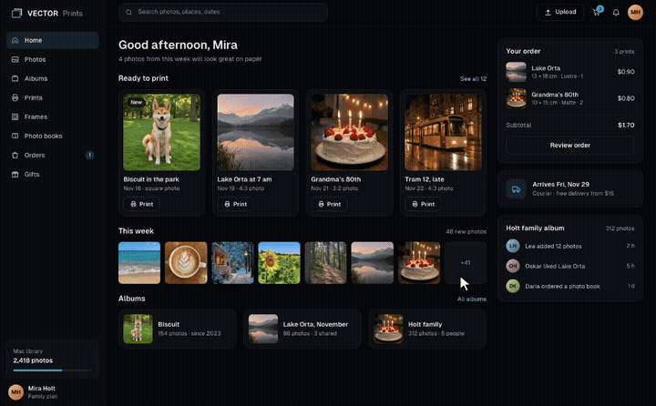

# Fit to Print

**Printing a square photo on a 10×15? The ears go first.**



**Live demo:** [veraetogrex-portfolio.github.io/fit-to-print](https://veraetogrex-portfolio.github.io/fit-to-print/) · **Mockup:** [full-screen version](https://veraetogrex-portfolio.github.io/fit-to-print/mockup/fit-to-print.html)

A photo print screen: Fill the paper shows what gets cut past the sheet, Whole photo fits the square photo with white borders, then it goes into the order. Vanilla HTML/CSS/JS, zero dependencies.

## Try it

- Press Print on "Biscuit in the park". The print settings open with Fill the paper selected: the square photo runs past the top and bottom of the 10 × 15 sheet, the ears show faded above the dashed cut line and a warning reads "Ears will be cut off in print".
- Pick Whole photo. The photo shrinks inside the same sheet in 0.8 s: the ears land on the paper and white borders appear left and right. Switch back and forth mid-animation — the last choice wins.
- Press Add to order. The button turns into "Added to order", the cart counts 3 → 4.
- Keyboard: Tab to the Fit on paper group, arrow keys switch the mode.
- With reduced motion on, the photo changes size at once.

## Use it

Three files and the photos, no build step, no dependencies:

```
index.html   markup
style.css    styles
script.js    logic
assets/      the photos (generated, free to reuse with the code)
```

Download the repo and open `index.html`, or copy the files into your project. Set `data-assets` on `<section class="vp">` to the folder with your photos.

## License

MIT
